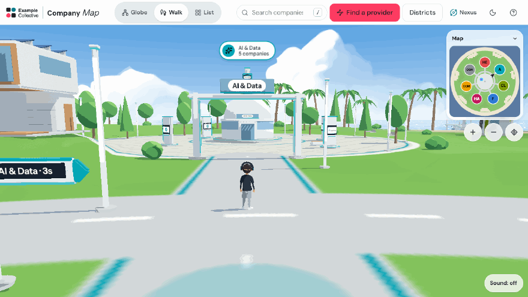
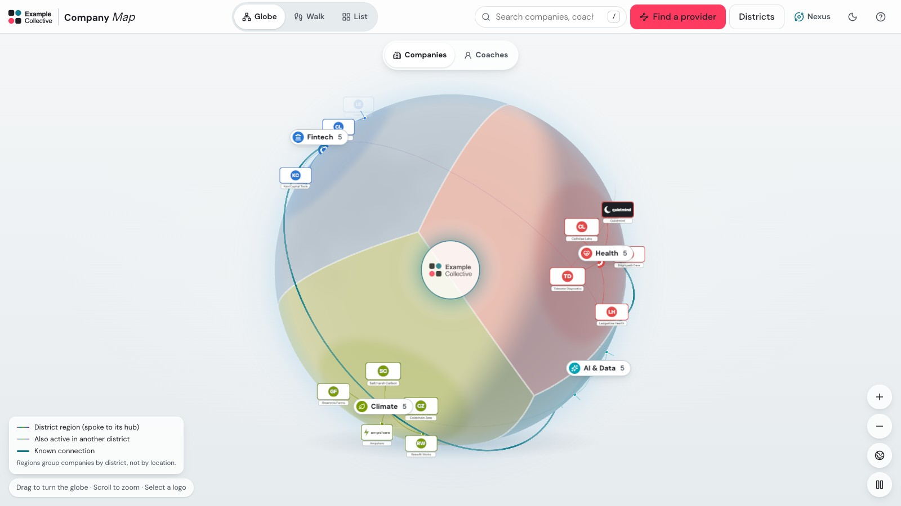
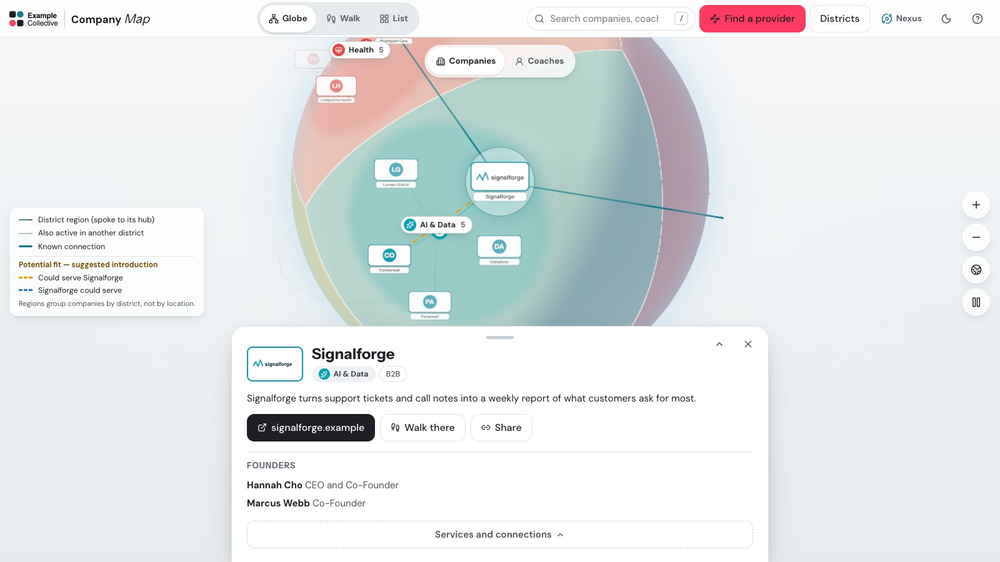
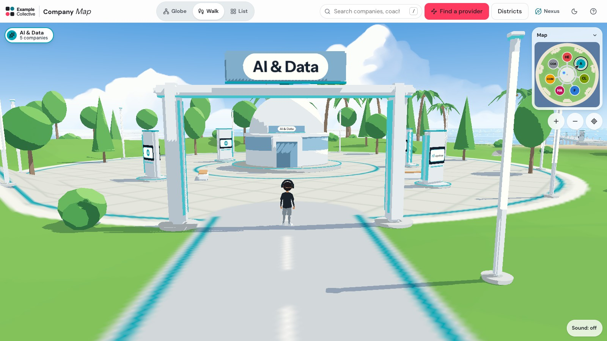
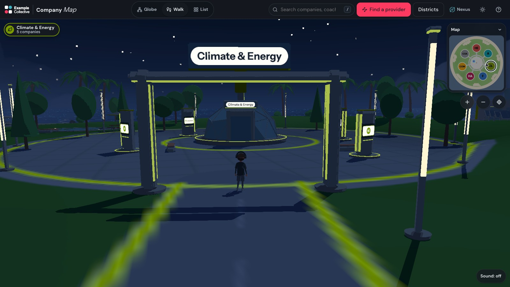
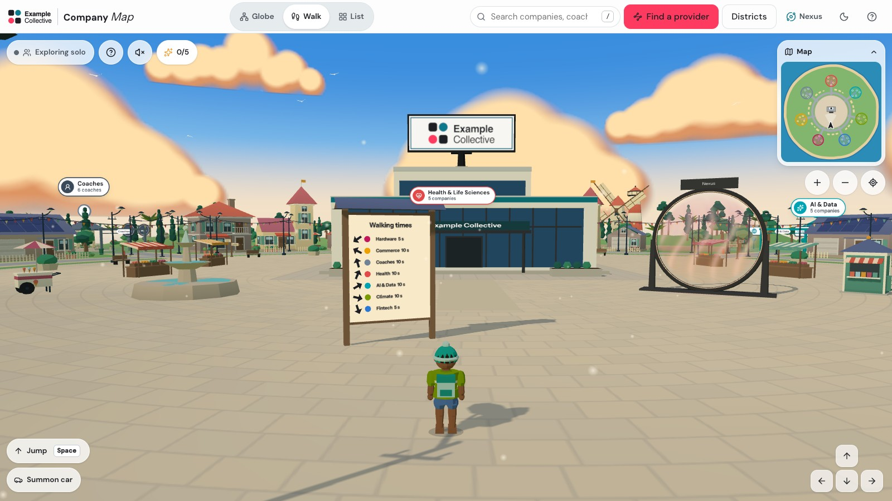
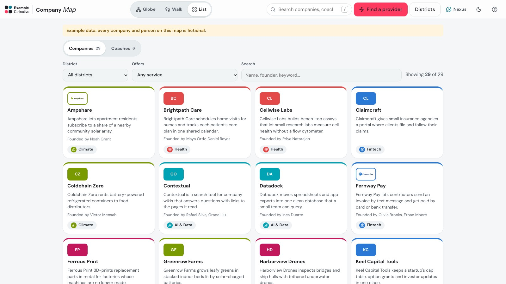
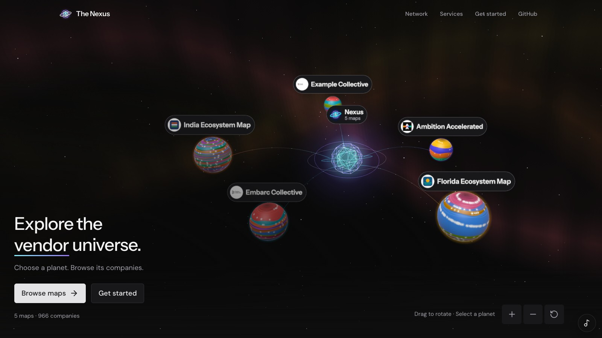

<div align="center">

<a href="https://wearenexus.xyz/example/?view=walk"></a>

# portfolio-map-3d

**An organization's companies as a 3D map: a turning globe, a world you walk through, and a directory.**

For an accelerator's cohort, an incubator's members, a fund's portfolio, a region's startups or an event's exhibitors.

[](https://wearenexus.xyz/example/)
[](https://wearenexus.xyz)

[](https://github.com/fritzhand/portfolio-map-3d/actions/workflows/ci.yml)
[](./LICENSE)
[](./docs/getting-started.md)
[](./tsconfig.json)
[](https://react.dev)
[](https://threejs.org)
[](https://vite.dev)
[](./art/README.md)
[](./docs/mcp.md)
[](https://github.com/fritzhand/portfolio-map-3d/stargazers)

[Live demo](https://wearenexus.xyz/example/) · [Get started](#start-your-own-map) · [Two walk worlds](#two-walk-worlds) · [The network](#the-portfolio-map-network-and-the-nexus) · [Docs](#documentation)

</div>

<br>

<table>
  <tr>
    <td width="50%"><br><sub><b>Globe.</b> Each district owns a region of the sphere; arcs show documented connections.</sub></td>
    <td width="50%"><br><sub><b>Details.</b> Select a logo for the company, its connections and its potential fits.</sub></td>
  </tr>
  <tr>
    <td><br><sub><b>Campus by day.</b> A gateway, a landmark in the district's theme, a screen totem per company.</sub></td>
    <td><br><sub><b>Campus at night.</b> The dark theme turns on the lights.</sub></td>
  </tr>
  <tr>
    <td><br><sub><b>Classic world.</b> The village built entirely in code, with live explorers.</sub></td>
    <td><br><sub><b>List.</b> Every record, searchable and filterable, no 3D required.</sub></td>
  </tr>
</table>

## What you get

| | |
|---|---|
| **Globe** | A slowly turning globe of logos. Each district (a sector, a track, a program) owns a region; arcs show documented connections. An optional second globe shows the organization's people (coaches, mentors, advisors). |
| **Walk** | Your own explorer on an island: a plaza with the organization's name at its center, a road out to every district, and each company standing in its district. Walk up to a company and its details slide up. WASD or the arrow keys to move, Shift to run, Space to jump, click a district or the map to hop there. Touch controls do the same. |
| **List** | The same records as a searchable, filterable directory. Every record is reachable here. |
| **Provider finder** | "Is there a company here that can do this for me?", matched on services and industries and labeled as a suggestion. |
| **Deep links** | Every company, person, district, filter and view has a URL. |
| **Data contract** | Every fact keeps its source; a validator checks `site/` before every build and the build ships no provenance. |

## Two walk worlds

A map picks its walk world in `site/site.json`. Both ship with the framework; a visit loads only
the one the site chose.

```json
"walk": { "world": "campus" }
```

| | **Campus** (default) | **Classic** |
|---|---|---|
| Look | A tech campus on an island: white buildings, glass, screens and lines of light; daylight in the light theme, the campus at night in the dark one | A village on an island: houses on a ring street, a fountain and market stalls on the plaza, a gazebo in every district, and set pieces on the coast and hills (a lighthouse, a pier, a windmill, an orchard, an observatory...); afternoon in the light theme, moonlight in the dark one |
| Built from | Blender build scripts in [`art/`](./art/README.md), exported as compressed models | TypeScript only ([`src/views/walk`](./src/views/walk)): no model files, no Blender |
| Each company | A screen totem with its logo on both faces | A drop pin with its logo badge |
| Each district | A gateway, a pylon and a landmark in its theme (lab, greenhouse, bank, studio...) | A neighborhood crowned by a gazebo in its color |
| Also | A shuttle on the ring street, a marina you can walk out on, a wind turbine and an observatory | Five keepsakes to find, a car to summon, synthesized sound, explorers with hats and gear |
| Live explorers | Not yet | Yes ([Supabase Realtime](./docs/live-explorers.md)) |
| Switch parts off | No | The village, the set pieces (all, none or a list), the keepsakes, the wildlife and the sound ([walk-world.md](./docs/walk-world.md)) |
| To restyle it | Edit the Blender scripts and rebuild the models (`npm run art`, Blender 5). The richer look; it takes more time, and more tokens if an AI assistant does it | Edit the TypeScript. Fewer steps and fewer tokens for an AI assistant |

[docs/configuration.md](./docs/configuration.md#the-walk-world) has the details of each.

## Start your own map

Node 22.18 or later.

```bash
npx degit fritzhand/portfolio-map-3d my-map      # or "Use this template" on GitHub
cd my-map
npm install
npm run dev                                      # http://localhost:5173, with the example data
```

The example in `site/` is a fictional organization, **Example Collective**, so you can see every
feature before you change anything. It is also live at https://wearenexus.xyz/example/. Then:

```bash
npm run new-site -- --name "Acme Ventures" --id acme-ventures --url https://map.acme.vc --world campus   # or --world classic
# edit the districts in site/taxonomy.json
npm run import -- companies.csv --source-title "Acme portfolio" --source-url https://acme.vc/portfolio
# drop logos into site/logos/<slug>.png|svg|webp|jpg and your logo into site/brand/
npm run dev
npm run build                                    # validates, type-checks, builds dist/, checks the bundle
```

Deploy `dist/` to any static host ([docs/deploying.md](./docs/deploying.md)), then add
`registry/instances/<your-id>.json` by pull request to join the network
([docs/network.md](./docs/network.md#joining)).

**Your content lives in `site/`, and only there.** Everything else is the framework, so you can
pull framework updates (`git pull upstream main`) without conflicts.

### Or build it with an AI assistant

The repository includes a local MCP server that builds `site/` through the same content contract:
it creates the site, sets the districts, imports companies with their sources (from a spreadsheet,
or from an app you have connected such as a CRM or a database, with a preview you confirm), adds
logos and picks the walk world, and refuses any change the validator would reject.
[docs/mcp.md](./docs/mcp.md) has the setup for Claude Code, Claude Desktop and other MCP clients.

## The Portfolio Map Network and the Nexus



Every map built with this framework is one world in a shared network. **The one requirement**: your
map links to **the Nexus**, a 3D world where every map in the network is a planet of its own, so
anyone visiting one map can see and travel to all the others.

Linking is open to every map; **appearing in the Nexus takes a short handshake**:

1. **Publish.** `npm run build` writes `/portfolio-map.json`: who you are, who publishes the map,
   your districts and a light public index of your companies, from the same data the map shows.
2. **Link.** A portal on the walk world's plaza, a **Nexus** button in the top bar, a section in the
   About panel, and a meta tag in `index.html`. `npm run build` fails if they are gone.
3. **Prove.** Your organization vouches for the map: the map lives on your own domain (nothing to
   do), or your homepage links to it, or a DNS TXT record says so.
4. **Review.** A maintainer approves the one-file pull request that adds you to
   [`registry/instances/`](./registry).

`npm run join-check -- https://your-map` checks the first three against your live map before you
apply. The Nexus ([`nexus/`](./nexus), live at **https://wearenexus.xyz**) re-checks every map each
time it is built: a map that stops linking or loses its proof drops out. [NETWORK.md](./NETWORK.md)
has the terms and the review criteria; [docs/network.md](./docs/network.md) the protocol.

**Rather have it built for you?** The maintainers offer a paid service: setup, a custom walk world
in your branding, and ongoing care. See "Services" on the
[landing page](https://wearenexus.xyz/#built-for-you), or request a setup by email at
[jeremy@embarccollective.com](mailto:jeremy@embarccollective.com?subject=Setup%20request).

## Principles

- **Provenance first.** Every fact keeps its source in the data (`sources`, `descriptionSource`,
  each founder's `source`); the validator fails a record without one. Nothing is invented: unknown
  stays `null` and the interface leaves it out. The live map does not display sources; the
  production build drops them from the bundle.
- **No personal contact data.** Email addresses, phone numbers and home addresses are rejected in
  every string, at import, at validation and in the network manifest.
- **Documented vs derived.** A *known connection* needs a source naming both companies. A
  *potential fit* is derived from services and industries and is always labeled as a suggestion.
- **People are not linked to companies.** The people roster has no connections, highlights or
  suggestions to companies.
- **Static and serverless.** No database, no secrets; host `dist/` anywhere. The only optional
  service is Supabase Realtime for live explorers.
- **Accessible.** Every record is reachable without 3D; keyboard and screen reader routes;
  reduced motion is honored; contrast is checked.

## Documentation

| | |
|---|---|
| [docs/getting-started.md](./docs/getting-started.md) | From the example to your own map, step by step |
| [docs/configuration.md](./docs/configuration.md) | `site/site.json`, the walk world, the taxonomy, labels, theme, logos |
| [docs/data-contract.md](./docs/data-contract.md) | The records, their sources, what never ships |
| [docs/importing.md](./docs/importing.md) | Companies from a spreadsheet |
| [docs/network.md](./docs/network.md) | The manifest, the registry, the Nexus, joining |
| [docs/deploying.md](./docs/deploying.md) | Vercel, Netlify, GitHub Pages, any static host |
| [docs/walk-world.md](./docs/walk-world.md) | The classic walk world: what you can switch off, how it is laid out, adding your own set pieces |
| [docs/live-explorers.md](./docs/live-explorers.md) | Multiplayer in the classic walk world (optional, Supabase Realtime) |
| [docs/mcp.md](./docs/mcp.md) | Build a map with an AI assistant (MCP), and the sites' tools for agents (WebMCP) |
| [art/README.md](./art/README.md) | The campus's models: built in Blender from code |
| [docs/architecture.md](./docs/architecture.md) | How the code is laid out, and why |

## What's in the repository

```
site/              YOUR map: site.json, taxonomy.json, data/, logos/, people/, brand/  (the example)
src/               the map app (Vite + React 19 + TypeScript + three.js / React Three Fiber)
  views/walk/      the walk view: the classic world, and the host for the campus
  island/          the campus world: its plan, ground, engine and scene
art/               the campus's models, as Blender build scripts (npm run art)
scripts/           validate-site, manifest, import-csv, new-site, check-bundle, build-network, build-art
federation/        the network protocol: types, links, manifest and registry checks; agent tools
mcp/               the builder: a local MCP server that builds site/ through the content contract
nexus/             the Nexus: the landing page and the shared world
registry/          one JSON file per map in the network
schema/            site.schema.json, for editor autocompletion
docs/              guides, and the screenshots above (docs/media/)
```

## Commands

```bash
npm run dev            # the map, with the example or your site/
npm run validate       # the content contract on site/
npm test               # unit tests: data contract, layouts, provider matching, live explorers, the protocol
npm run build          # validate + type-check + build dist/ + check the bundle (keys, provenance, the Nexus link)
npm run manifest       # print the network manifest your build will publish
npm run import         # companies from a CSV (docs/importing.md)
npm run new-site       # replace the example with a blank site for your organization
npm run join-check -- https://your-map   # the linking handshake against your live map, before you apply
npm run mcp -- --list  # the builder's tools; MCP clients start node mcp/server.mjs (docs/mcp.md)
npm run art            # rebuild the campus's models with Blender 5 (art/README.md)
npm run registry:check # the registry's entries (CI runs it)
npm run nexus:dev      # the Nexus, locally (add ?sample for sample worlds)
npm run nexus:build    # fetch the network (scripts/build-network.mjs) and build the Nexus
```

In development, `?world=classic` or `?world=campus` on the walk view tries the other world without
changing `site.json`, and `?kit` opens a gallery of every model the classic world is made of.

## Origin

It is the generalized version of two production maps: the
[Embarc Member Map](https://community.embarccollective.com) and the
[Ambition Accelerated Community Map](https://ambition.embarccollective.com).

## License

[MIT](./LICENSE) for the framework's code. The example data in `site/` is fictional. A map's own
data (names, logos, descriptions, photos) belongs to whoever publishes it. That includes the
network snapshot the Nexus ships (`nexus/public/network.json`, `nexus/public/instances/`) and its
link-preview image (`nexus/public/og.png`): they carry the registered maps' public manifests and
logos, which their publishers own and which the MIT license does not cover. The same holds for the
Nexus screenshot above, which shows the registered maps' names and logos.
